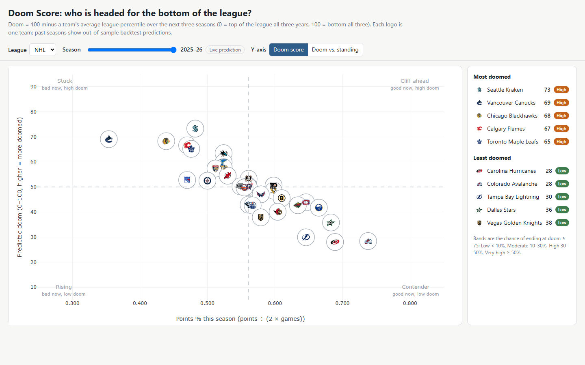
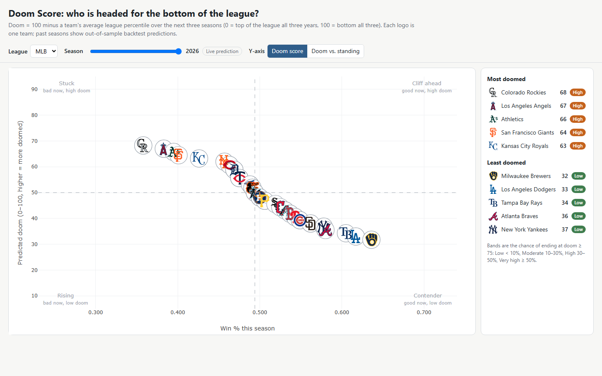
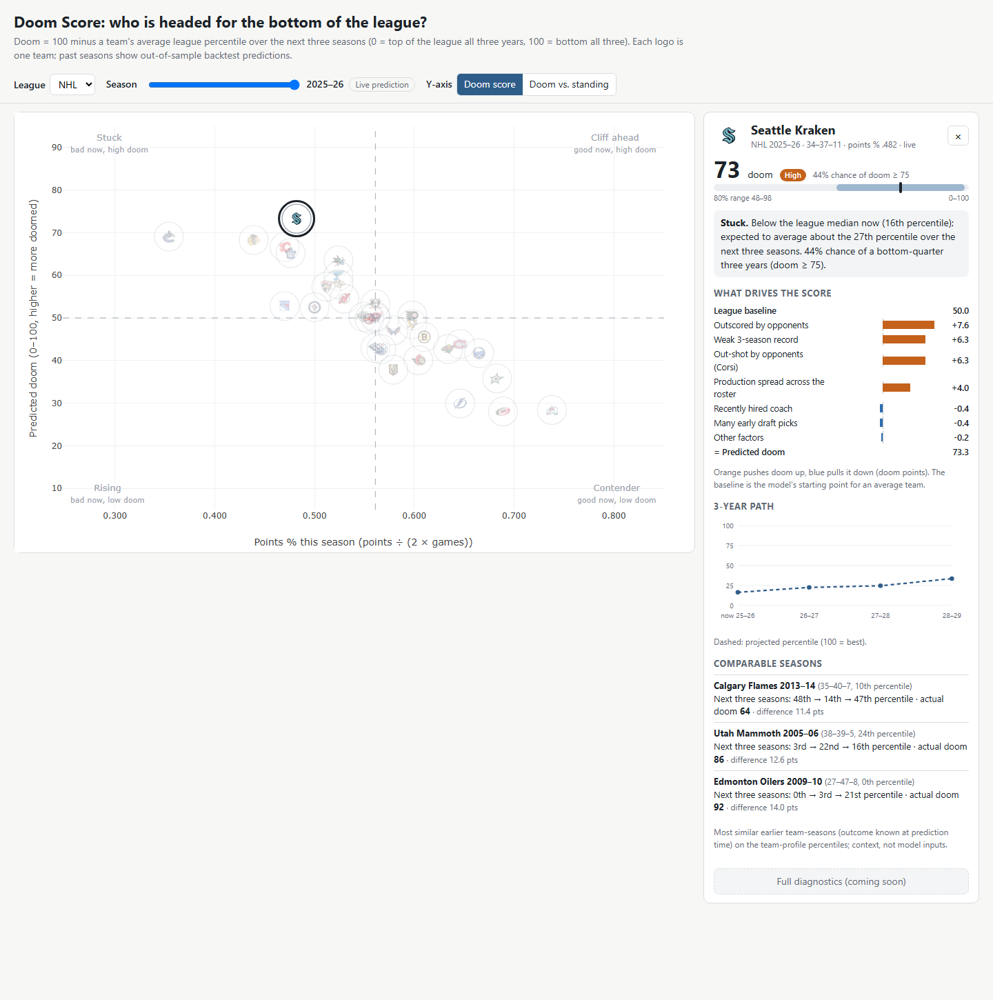
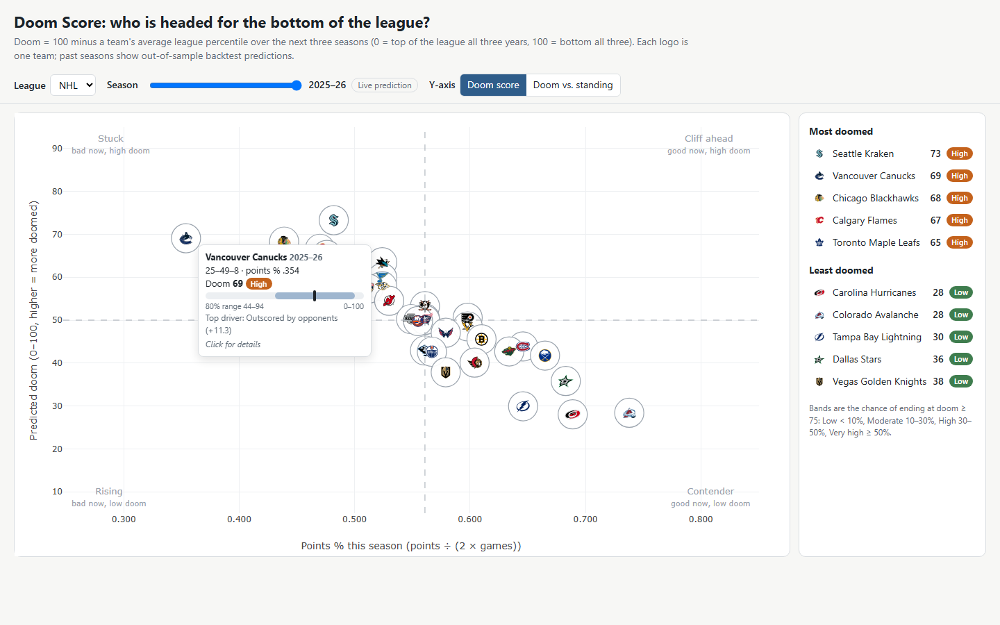
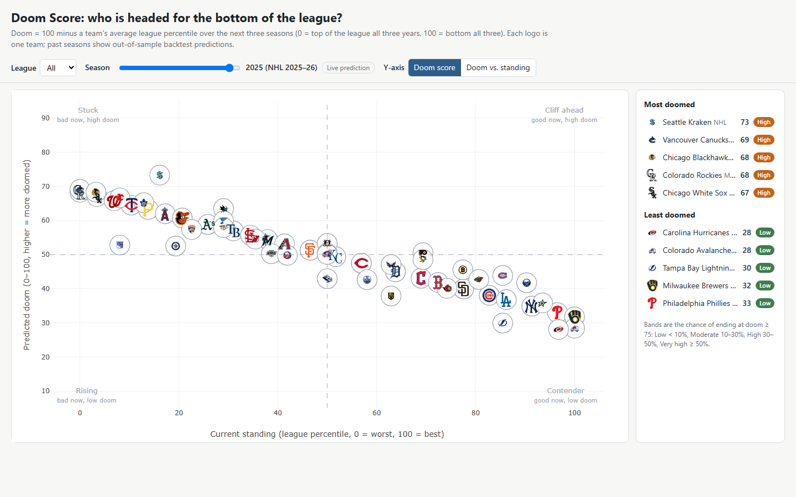
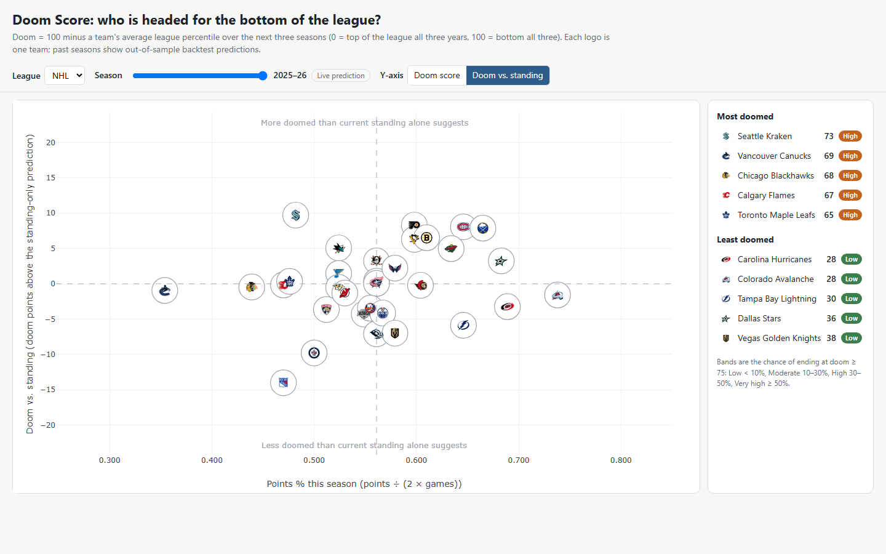

# Phase V1: scatter prototype with team logos

`dashboard/doom_scatter.html`: one self-contained file (Plotly, plotly.js, data and logos inlined; 7.2 MB), opens in
any browser with no server. Built from `dashboard/data/` only. Decisions D102–D108.

**Build:** `python src/viz/fetch_logos.py` (once) → `python src/viz/build_comparables.py` →
`python src/viz/build_scatter.py`. The built HTML and `dashboard/assets/logos/` are git-ignored, because the HTML
embeds the trademarked logos (D105). Rebuild locally to open it.

## What it does

- **Scatter:** one logo per team (34 px; 28 px in "All"), on a light outline circle. x = win % (MLB) or points %
  (NHL); in "All", x = league percentile. y = predicted doom. Dashed guides at the season's league median (50 in
  "All") and y = 50, with corner labels Stuck / Cliff ahead / Rising / Contender.
- **Controls:**
  - League: MLB / NHL / All (default NHL).
  - Season slider: defaults to the latest season; past seasons show backtest predictions, tagged "Backtest
    (out-of-sample)".
  - **Y toggle:** "Doom score" / "Doom vs. standing" (doom − B1 prediction).
- **Hover card (5 lines):** team; record; doom + band; 80% range as a small bar (or "range not available"); the
  top driver (MLB: "Based on current standing only"); "Click for details".
- **Click:** opens a right-hand panel. The chart shrinks and stays visible, the selected logo is ringed and the
  others fade. The panel shows:
  - score, band, p(doom ≥ 75) and the 80% range;
  - a verdict line (quadrant, current percentile, expected percentile, chance of ≥ 75);
  - a diverging driver list from the league baseline to the prediction (top 6 + "Other factors"), plus the MLB
    note;
  - the 3-year path (projected, plus actual where known);
  - the top 3 comparables;
  - a disabled "Full diagnostics (coming soon)" button.

  Esc or × closes it.
- **Lists:** top 5 most and least doomed beside the chart. They are keyboard-accessible and open the panel.
- **URL hash** keeps the view (`#league=NHL&season=2025&y=doom&team=seattle-kraken`). `&tip=<franchise>` shows one
  hover card without a mouse; it is a review aid, used for the hover screenshot.

## Screenshots

| View | File |
|---|---|
| NHL default (2025–26, live) |  |
| MLB (2026, live) |  |
| Open side panel (Seattle Kraken 2025–26) |  |
| Hover card (Vancouver Canucks) |  |
| All leagues |  |
| Doom vs. standing (NHL) |  |

## Logos

All 62 franchises loaded (MLB from mlbstatic.com, NHL from the NHL API `teamLogo`); **no failures**. The labelled-dot
fallback is implemented but unused. Each franchise's current logo is used for every season.

## Overlap and readability

- **MLB is a single curve.** The MLB score is B1 (standing only), so every team sits on one line. Logos around .500
  stack (about 33 overlapping pairs among 30 teams in 2026). "Doom vs. standing" is flat at 0 for MLB by
  construction; the chart says so.
- **NHL** has real vertical spread: about 20 overlapping pairs, mostly the cluster at .54–.58 points % / doom 45–55.
- **All leagues** (62 logos) is the most crowded, especially at low standing / doom 60–70, where MLB's line and NHL's
  bad teams meet.
- **Suggested fixes:**
  - collision-aware nudging along x only, so y (the score) stays exact;
  - smaller logos (24 px) or league-coloured dots with logos on hover in "All";
  - a "highlight one league" toggle in "All";
  - for MLB, rely on the side lists or show rank instead of win % on x.

  I avoided random jitter: it would move points off their true values.
- The NHL logo SVGs have built-in padding, so they look smaller than MLB logos at the same size.
- Chart points are not keyboard-focusable (a Plotly limitation); the lists are the keyboard path.

## Data added for V1

- `doom_predictions.csv`: `b1_pred` and `doom_vs_standing` (D102).
- **New file `dashboard/data/comparables.csv`.** It did not exist yet, so I built it (D103): the 3 most similar
  earlier team-seasons (outcome known by the prediction moment, seasons ≤ T−3) in the same league. Similarity is the
  RMS difference over the team-profile percentiles. Median distance is 17 percentile points, so comparables are
  loose matches, labelled as context.
